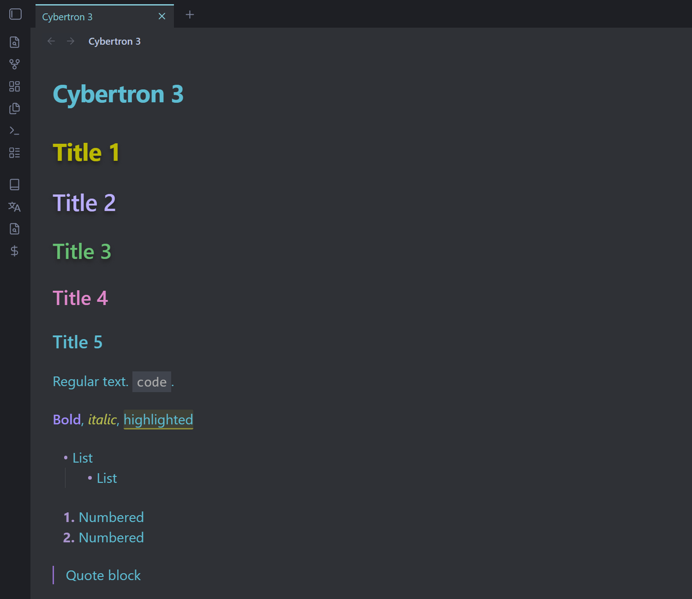

# Cybertron 3

A dark theme for [Obsidian](https://obsidian.md), based on [LYT Mode](https://github.com/nickmilo/LYT-Mode) by Nick Milo, which itself evolved from [Cybertron](https://github.com/nickmilo/Cybertron).

## What's different from LYT Mode

- Softer cyan accent and pink links. External links are italic, with no underline.
- Recolored headings (H1–H6), bold and italic text.
- Tighter line height (1.33 instead of 1.58).
- Code at full text size, on a lighter code-block background.
- A more neutral, less blue main background.
- Cyan highlight for the active tab, and a red window close button on hover.
- Muted grey file and folder names in the file explorer.

Every change is marked with a `Custom` comment in `theme.css`, with the original value where there was one (for example `/* Custom, was 1.58 */`).

## Installation

### From the community theme directory

1. Open **Settings → Appearance**.
2. Next to **Themes**, select **Manage**.
3. Search for **Cybertron 3**, then select **Install and use**.

### Manually

1. Download `theme.css` and `manifest.json` from the [latest release](https://github.com/igor2c/cybertron-3/releases/latest).
2. Put them in `<your vault>/.obsidian/themes/Cybertron 3/`.
3. Open **Settings → Appearance** and choose **Cybertron 3** under **Themes**.

Cybertron 3 is a dark-only theme. Under **Settings → Appearance → Base color scheme**, choose **Dark**.

## Credits

- [Nick Milo](https://github.com/nickmilo), for LYT Mode and Cybertron.
- [Boxicons](https://boxicons.com), for the icons (MIT License).
- [DM Sans](https://fonts.google.com/specimen/DM+Sans) and [DM Mono](https://fonts.google.com/specimen/DM+Mono), for the fonts (SIL Open Font License 1.1). They are embedded in the theme, so it works offline.

## License

[MIT](LICENSE)
